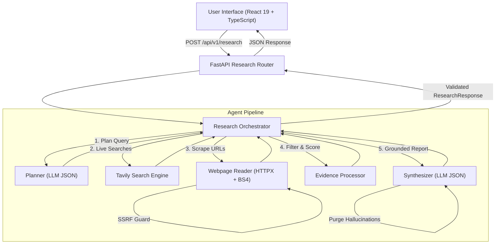

# ResearchPilot 🧭

**An Autonomous, Citation-Grounded Full-Stack AI Research Agent**

ResearchPilot is an autonomous research workspace that investigates complex queries by decomposing questions into structured strategies, searching the live web via Tavily, extracting clean textual content using HTTPX and BeautifulSoup under strict SSRF protections, and synthesizing findings anchored to verified citations.

---

## 🌟 Key Features

* **Dynamic Research Planning**: Decomposes multi-faceted questions into targeted search queries, subquestions, and execution steps using structured JSON models.
* **Live Web Evidence Retrieval**: Real-time search powered by Tavily with canonical URL normalization and query parameter stripping (`utm_*`, `ref`).
* **Resilient Page Content Extraction**: Cleans noise elements (`script`, `style`, `nav`, `footer`, `header`, `aside`) while preserving substantive text.
* **Strict SSRF Security Protection**: Pre-flight validation blocking localhost, private subnets (RFC 1918), cloud metadata endpoints (`169.254.169.254`), non-HTTP schemes, and manual redirect re-validation.
* **Grounded Citation Verification**: Automatically cross-references generated citation IDs against actually retrieved sources, eliminating hallucinated URLs and phantom citations.
* **Honest Uncertainty & Limitations**: Displays High, Medium, or Low confidence ratings, flags data gaps, and surfaces explicit limitations rather than fabricating facts.
* **Professional Light Workspace**: Built with React 19, TypeScript, and Tailwind CSS; featuring comparative analysis tables, citation jump links, and one-click Markdown export.

---

## 🏛️ System Architecture



---

## 🧰 Technology Stack

| Layer | Technologies |
| :--- | :--- |
| **Frontend** | React 19, TypeScript 5, Vite 6, Tailwind CSS 3, Lucide React |
| **Backend** | Python 3.13, FastAPI, Pydantic v2, Pydantic-Settings, Uvicorn |
| **LLM & Search** | OpenAI API SDK (`gpt-4o-mini`), Tavily Search SDK (`AsyncTavilyClient`) |
| **Extraction & Security** | HTTPX (async client), BeautifulSoup4, `ipaddress`, `socket` (SSRF guard) |
| **Testing** | Pytest 9, Pytest-Asyncio, AnyIO |

---

## 📁 Repository Structure

```
Research Pilot/
├── backend/
│   ├── app/
│   │   ├── agent/               # Autonomous agent logic
│   │   │   ├── planner.py       # Dynamic query decomposition
│   │   │   ├── evidence_processor.py # Deduplication & relevance scoring
│   │   │   ├── synthesizer.py   # Grounded report synthesis
│   │   │   └── orchestrator.py  # 10-step execution pipeline
│   │   ├── api/
│   │   │   └── v1/
│   │   │       ├── health.py    # System & tool health probes
│   │   │       └── research.py  # Primary research endpoint
│   │   ├── services/
│   │   │   └── llm_service.py   # OpenAI client with bounded retries & JSON mode
│   │   ├── tools/
│   │   │   ├── web_search.py    # Tavily integration with URL normalization
│   │   │   └── webpage_reader.py# HTTPX + BS4 extractor with SSRF protection
│   │   ├── config.py            # Pydantic Settings & lazy credential validation
│   │   └── main.py              # FastAPI app, timing middleware, safe error handlers
│   ├── tests/                   # 58 unit and integration tests
│   ├── requirements.txt         # Pinned Python dependencies
│   ├── pytest.ini               # Pytest asyncio configuration
│   └── .env.example             # Backend configuration template
├── frontend/
│   ├── src/
│   │   ├── components/          # Modular React components
│   │   │   ├── Header.tsx       # Branding and backend status
│   │   │   ├── ResearchInput.tsx# Multiline input, validation & controls
│   │   │   ├── ExampleQueries.tsx # Selectable research prompts
│   │   │   ├── LoadingState.tsx # Honest loading indicator
│   │   │   ├── ErrorDisplay.tsx # Human-readable error alerts & instructions
│   │   │   ├── ConfidenceBadge.tsx # High/Medium/Low confidence indicator
│   │   │   ├── ComparisonTable.tsx # Dynamic comparison matrix
│   │   │   ├── FindingsList.tsx # Grounded key findings with citation tags
│   │   │   ├── SourcesList.tsx  # Source cards with publisher links
│   │   │   └── ResearchReport.tsx # Report container with Markdown export
│   │   ├── services/
│   │   │   └── api.ts           # HTTP client and error classification
│   │   ├── types/
│   │   │   └── research.ts      # TypeScript interfaces matching backend models
│   │   ├── App.tsx              # Main dashboard view
│   │   └── index.css            # Tailwind CSS base styles
│   ├── package.json             # Frontend dependencies
│   ├── vite.config.ts           # Vite configuration
│   └── tailwind.config.js       # Tailwind theme configuration
├── evaluation/
│   ├── test_cases.md            # 8 diverse evaluation benchmark cases
│   ├── rubric.md                # 100-point scoring rubric
│   ├── demo_script.md           # 3-5 minute demo video walkthrough script
│   └── sample_outputs/          # Illustrative output schemas
├── .gitignore                   # Excludes credentials, .venv, node_modules, and cache
├── .env.example                 # Root environment template
└── README.md                    # Project documentation
```

---

## ⚡ Prerequisites

* **Node.js**: v18.0+ and `npm`
* **Python**: v3.10+ (tested on Python 3.13)
* **API Keys** (for live runs):
  * [OpenAI API Key](https://platform.openai.com) (`OPENAI_API_KEY`)
  * [Tavily Search API Key](https://tavily.com) (`TAVILY_API_KEY`)

---

## 🚀 Setup & Installation

### 1. Backend Setup

```bash
# Navigate to backend directory
cd backend

# Create and activate Python virtual environment
# Windows (PowerShell):
python -m venv .venv
.venv\Scripts\Activate.ps1

# macOS / Linux:
# python3 -m venv .venv
# source .venv/bin/activate

# Install dependencies
pip install -r requirements.txt

# Configure environment variables
cp .env.example .env
```

Edit `backend/.env` with your preferred credentials:
```ini
OPENAI_API_KEY=your_actual_openai_key_here
TAVILY_API_KEY=your_actual_tavily_key_here
LLM_PROVIDER=openai
LLM_MODEL=gpt-4o-mini
HOST=0.0.0.0
PORT=8000
FRONTEND_ORIGINS=["http://localhost:5173","http://127.0.0.1:5173"]
REQUEST_TIMEOUT_SECONDS=15.0
MAX_SEARCH_QUERIES=3
MAX_SOURCES=5
```

> [!IMPORTANT]
> The backend boots without requiring external keys. If keys are missing, endpoints return clean `HTTP 503 MISSING_CREDENTIALS` errors with remediation instructions, rather than crashing.

---

### 2. Frontend Setup

```bash
# Navigate to frontend directory
cd frontend

# Install npm dependencies
npm install

# (Optional) Verify environment template
cp .env.example .env
```

---

## 🖥️ Running the Application

Start the backend and frontend in separate terminals:

### Terminal 1 — Backend (FastAPI)
```bash
cd backend
.venv\Scripts\uvicorn app.main:app --reload --port 8000
```
* **API Server**: `http://localhost:8000`
* **Interactive Swagger UI**: `http://localhost:8000/docs`
* **Health Check**: `http://localhost:8000/health`

### Terminal 2 — Frontend (Vite)
```bash
cd frontend
npm run dev
```
* **Web Dashboard**: `http://localhost:5173`

---

## 📡 API Endpoints

### 1. Submit Research
`POST /api/v1/research`

**Sample Request**:
```json
{
  "query": "Compare the top three open-source vector databases for RAG applications.",
  "depth": "standard",
  "max_sources": 5
}
```

**Sample Response**:
```json
{
  "query": "Compare the top three open-source vector databases for RAG applications.",
  "status": "completed",
  "executive_summary": "For RAG workloads, Qdrant provides balanced performance and payload filtering...",
  "findings": [
    {
      "heading": "Architecture & Scalability",
      "content": "Milvus scales to billions of vectors [src-1]. Qdrant offers native payload search [src-2]...",
      "citations": ["src-1", "src-2"]
    }
  ],
  "plan": [
    {
      "step_id": 1,
      "description": "Execute web search query: Milvus Qdrant Chroma vector database comparison RAG",
      "search_query": "Milvus Qdrant Chroma vector database comparison RAG",
      "status": "completed"
    }
  ],
  "sources": [
    {
      "source_id": "src-1",
      "url": "https://milvus.io/docs/overview.md",
      "title": "Milvus Architecture Overview",
      "domain": "milvus.io",
      "snippet": "Milvus is a cloud-native vector database..."
    }
  ],
  "citations": [
    {
      "citation_id": "cite-1",
      "source_id": "src-1",
      "url": "https://milvus.io/docs/overview.md",
      "source_title": "Milvus Architecture Overview",
      "cited_claim": "Milvus scales to billions of vectors"
    }
  ],
  "confidence": {
    "score": 0.92,
    "level": "high",
    "explanation": "High confidence based on corroboration across official technical documentation."
  },
  "assumptions": ["Standard RAG embedding dimensions (384-1536)"],
  "limitations": ["Managed cloud costs vary based on instance sizing"],
  "suggested_next_steps": ["Run local recall benchmarks with your embedding model"],
  "execution_time_seconds": 4.18
}
```

### 2. Health Probes
* `GET /api/v1/health`: Overall health and integration readiness.
* `GET /api/v1/health/llm`: Provider status (`missing_credentials`, `configured`, `verified`).
* `GET /api/v1/health/tools`: Tool ecosystem status (Tavily search & built-in web extractor).

---

## 🧪 Testing & Verification

### Run Automated Backend Test Suite
```bash
cd backend
.venv\Scripts\pytest -v
```
**Results**: 58 automated tests passing in ~2.5s with 0 warnings or failures.
Coverage includes:
* Dynamic planner generation and server-side limit enforcement
* Tavily response parsing, URL normalization, and deduplication
* Webpage extraction, tag cleaning, and content truncation
* SSRF protection (loopback, RFC 1918 private IPs, metadata endpoint 169.254.169.254, redirect re-validation)
* Evidence scoring and total context budgeting
* Citation verification and hallucination purging
* Partial tool failure resilience and timeout handling
* Request validation (empty queries, too-short, >1000 characters, invalid source bounds)

### Run Frontend Production Build Check
```bash
cd frontend
npm run build
```
**Result**: 0 TypeScript errors, bundle generated cleanly in `dist/`.

---

## 🛡️ Security Considerations

* **SSRF Defenses**: The webpage reader validates every URL before sending network requests, performing asynchronous DNS lookups and rejecting private IPs (`10.0.0.0/8`, `172.16.0.0/12`, `192.168.0.0/16`, `127.0.0.0/8`, `::1`), link-local IPs, and cloud metadata (`169.254.169.254`). All redirect hops are re-validated.
* **Untrusted Data Isolation**: Webpage text is stripped of HTML scripts, forms, and style blocks, and passed strictly as quoted evidence data to the LLM rather than instructions.
* **Secret Hygiene**: Secrets are strictly read via `backend/.env` (which is excluded from Git via `.gitignore`). The configuration module masks keys in `safe_dict()`, and exceptions never echo raw API keys.
* **Link Security**: External source links open in new tabs with `rel="noopener noreferrer"`.

---

## 📊 Evaluation & Demo

* [Evaluation Benchmark Test Cases](file:///c:/Users/rishi/Desktop/Research%20Pilot/evaluation/test_cases.md): 8 diverse test cases with objectives, criteria, and results tracking.
* [100-Point Scoring Rubric](file:///c:/Users/rishi/Desktop/Research%20Pilot/evaluation/rubric.md): Quantitative evaluation rubric.
* [Demo Video Script](file:///c:/Users/rishi/Desktop/Research%20Pilot/evaluation/demo_script.md): Structured walkthrough script for a 3-5 minute presentation.
* [Sample Outputs](file:///c:/Users/rishi/Desktop/Research%20Pilot/evaluation/sample_outputs/): Sample response outputs.
